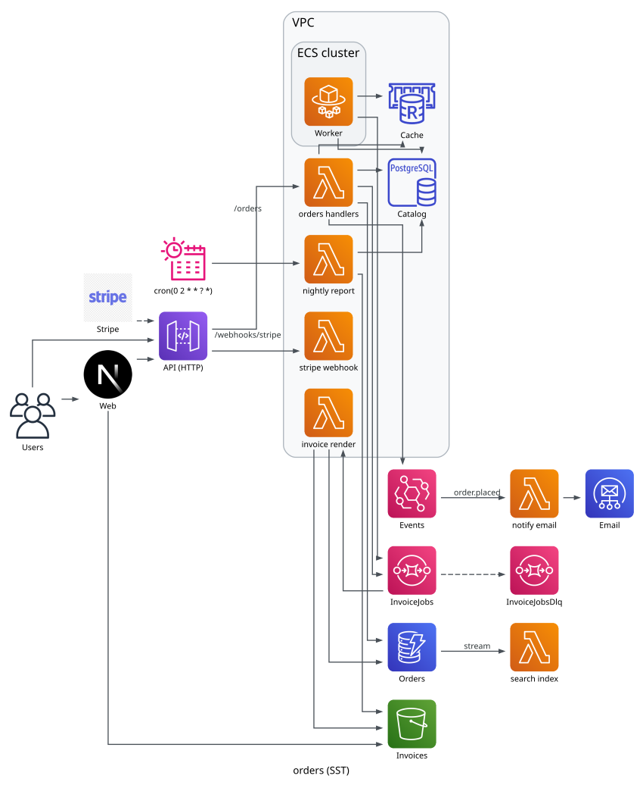
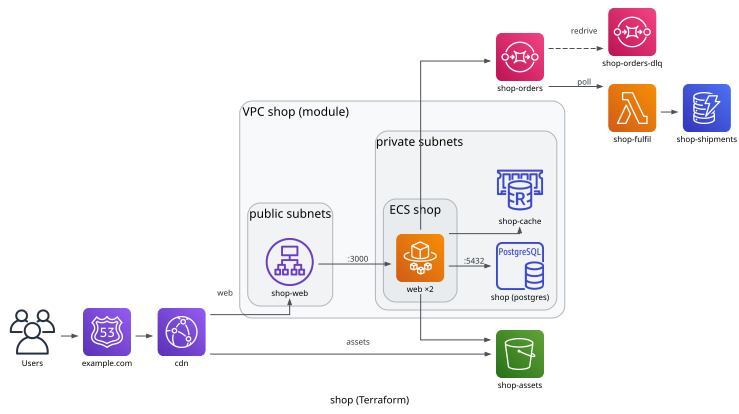

# diagrams

A Claude Code skill that turns infrastructure source into architecture diagrams. The agent reads an SST v3 app or a Terraform root, decides what belongs in the picture, writes a [diagrams-js](https://github.com/diagrams-js/diagrams-js) script, renders it, looks at the result, and commits the script plus SVG under `docs/architecture/`.

No Graphviz install, no dependency added to your project: the skill folder owns its `node_modules` and renders through diagrams-js's WebAssembly Graphviz.

## Install

```sh
git clone https://github.com/Jibaru/diagrams
cd diagrams/skills/diagrams && bun install
ln -s "$PWD" ~/.claude/skills/diagrams
```

Then, in any project, ask Claude Code for an architecture diagram, or invoke `/diagrams`.

## What the skill ships

| Path | Role |
| --- | --- |
| `skills/diagrams/SKILL.md` | The procedure the agent follows: find roots, inventory, resolve icons, write, render, look, finish. |
| `skills/diagrams/references/` | diagrams-js cheat-sheet with verified pitfalls, and how to read SST and Terraform source. |
| `skills/diagrams/data/*.json` | SST component and Terraform resource → icon tables, plus what stays hidden. Tested against the pinned diagrams-js. |
| `skills/diagrams/scripts/find-node.ts` | Catalog search over all 2,635 node factories (aliases included) printing import lines. |
| `skills/diagrams/scripts/render.ts` | Renders a diagram file to SVG/PNG from any directory. |
| `examples/` | An SST app and a Terraform root with the diagrams the skill produced from them. |

## Examples

SST app ([source](examples/sst-orders/sst.config.ts), [script](examples/sst-orders/docs/architecture/orders.diagram.ts)):



Terraform root ([source](examples/tf-shop/main.tf), [script](examples/tf-shop/docs/architecture/tf-shop.diagram.ts)):



## Manual use

```sh
cd skills/diagrams
bun scripts/find-node.ts api gateway --provider aws
bun scripts/render.ts /path/to/project/docs/architecture/app.diagram.ts --png
bun test
```

Diagram files end with `export default diagram;` and stay compatible with the `@diagrams-js/cli` `diagrams render` command.

## License

MIT. Icons come from diagrams-js, which bundles the vendors' official icon sets (AWS, Azure, Google Cloud, and others) under their respective terms.
